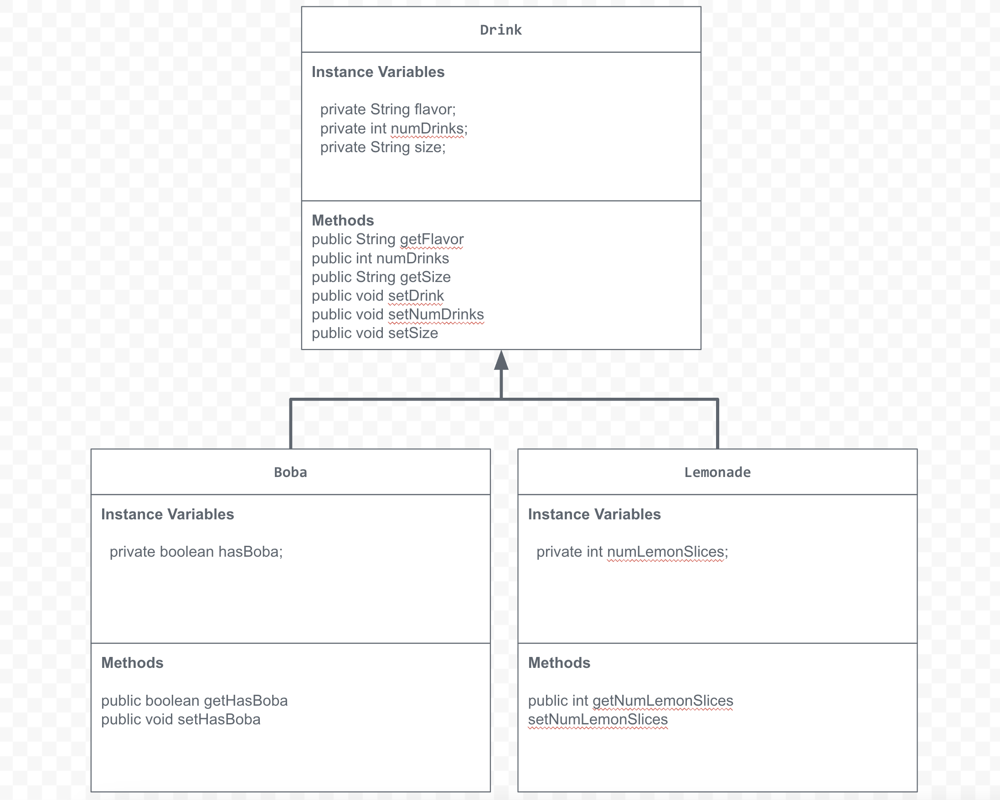

# Unit 2 - Store Management Project

## Introduction

You are opening a new business in your community! Businesses often need programs to manage the products and services they offer and track orders and requests from customers. Your goal is to create a store management system for your business.

## Requirements

Use your knowledge of object-oriented programming and class structure and design to create your store management system:
- **Create a class hierarchy** – Develop a superclass that represents a product or service your business offers and one or more subclasses that extend the superclass to represent more specific types of products or services.
- **Declare instance variables** – Declare instance variables in the superclass that are shared with the subclasses and instance variables in the subclasses that are not shared with the superclass.
- **Write constructors** – Write no-argument and parameterized constructors in the superclass and subclasses. Subclass constructors use the super keyword to call the superclass constructor.
- **Implement accessor and mutator methods** – Write accessor and mutator methods for instance variables that should be accessible and/or modifiable from outside of the class.
- **Implement a toString() method** – Write toString() methods in the superclass and subclasses that return information about the state of an object.

## UML Diagram

Embed your UML Diagram here. Upload the image of your UML Diagram to your repo, then use Markdown to insert your image here:

## Description

1. Write a description of your project here. Include what your store you made, and why you chose this topic. In your description, include as many vocab words from our class to explain how you represented the item/service from your store. If you have user input, explain how the user will interact with your store such as which questions are prompted to the user, what response is your program expecting, and how that is used to output information for your store in the console.

-In this project, I made a drinks store and printed the state of various instance variable objects using methods like mutator/accessor methods, toString() method, and multiple parameterized constructors. Using the values from the superclass "Drink", I made subclasses named "Boba" and "Lemonade" to represent specific drink objects. In the classes, I made various private instance variables and wrote no argument constructors, as well as parameterized constructors. Adding on, I adding mutator methods (set), accessor methods (get), and a toString method to print all the information in a string in the StoreRunner class. I chose this topic because I love drinks and there were lots of specific sub classes I could use.

2. How is this project related to STEAM (Science, Technology, Engineering, Art, and Mathematics)? Provide explicit examples from the project and details as possible. 

-This project relates specifically to science, technology, and engineering because I identified a purpose and used my coding skills to create work. For example, while I was writing my code, I made many syntax errors which caused issues with my code; but, using code.org's technology, they were able to recognize what was wrong and I was able to fix those errors. Additionally throughout this project, I was able to learn about how to use technology to create what I want.

3. What SLOs did you demonstrate during completing this project?

-In the engineering section of the SLOs, I developed a UML diagram and used that model to plan and write out my code. Additionally, I recognized the role that technology plays i nthe advancement of sciene and engineering while learning how to use technologies like code.org and github. Lastly, throughout this project, I asked many questions and was able to carry out coding experiments to print out the states of various objects in my code. Overall, I demonstrated various scientific SLO's likke technology and engineering by making diagrams and coding.
